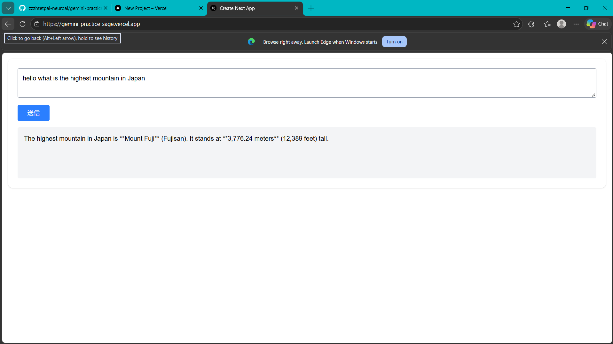
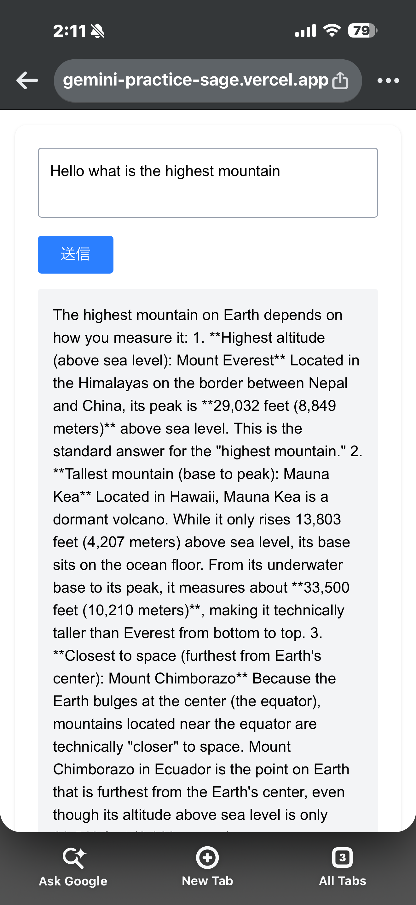

# Gemini Practice

A simple web app that asks Google's Gemini AI a question and shows the answer, built with Next.js, React, TypeScript and Tailwind CSS, and deployed on Vercel.

Live demo: https://gemini-practice-sage.vercel.app

## Features

- Type a question and get an answer from Gemini
- Shows "読み込み中..." (loading) while waiting for the answer
- Clear error messages (missing API key, Gemini errors, network errors)
- API key stays on the server and is never sent to the browser
- Works on PC and smartphone

## How it works

```
Browser (app/page.tsx)
   │ 1. sends the question with fetch → POST /api/gemini
   ↓
Next.js server (app/api/gemini/route.ts)   ← reads GEMINI_API_KEY from environment variables
   │ 2. calls the Gemini API with the key
   ↓
Google Gemini API
   │ 3. returns the answer
   ↓
Next.js server → returns the answer as JSON → shown on the page
```

- `app/page.tsx` runs in the browser (Client Component): input box, send button, answer area.
- `app/api/gemini/route.ts` runs on the server (API Route): uses the `@google/genai` SDK to call Gemini.
- The API key is stored in `.env.local` locally (excluded from Git by `.gitignore`) and in Vercel's Environment Variables in production.

## Screenshots

| PC | Smartphone |
|---|---|
|  |  |

## Tech stack

- Next.js (App Router)
- React + TypeScript
- Tailwind CSS
- Google Gen AI SDK (`@google/genai`)
- Vercel

## Run locally

1. Get an API key from [Google AI Studio](https://aistudio.google.com/)
2. Create `.env.local` in the project root:

```
GEMINI_API_KEY=your-api-key
```

3. Install and start:

```
npm install
npm run dev
```

4. Open http://localhost:3000

## Deploy

Push to GitHub, import the repository in Vercel, add `GEMINI_API_KEY` in Environment Variables, and deploy. Every push to `main` redeploys automatically.

## Possible improvements

- Keep chat history
- Disable the send button while waiting
- Render Markdown in answers (bold, lists)
- Rate limiting
- User authentication to protect the API route
